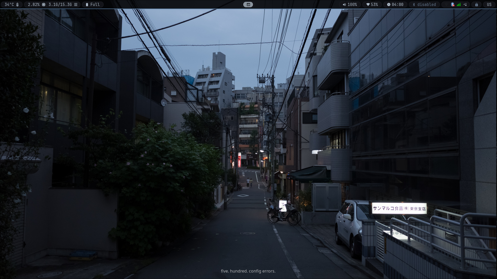

# dots 

### Screenshot

# install
basically add everything into ~/.config/ it should work fine

### Screen locker

The mel screen locker source, layouts, themes and build instructions are in [`config/mel`](config/mel/README.md).
